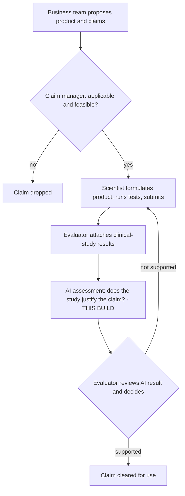
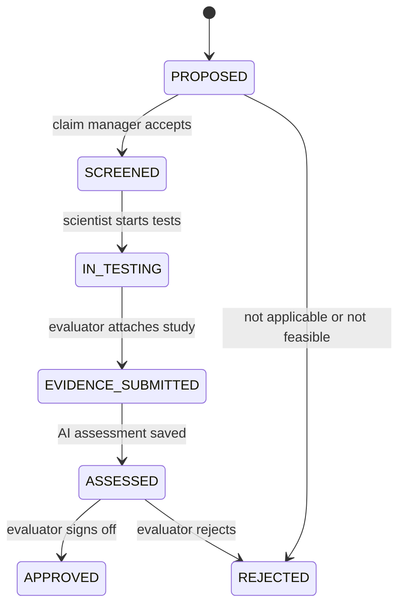
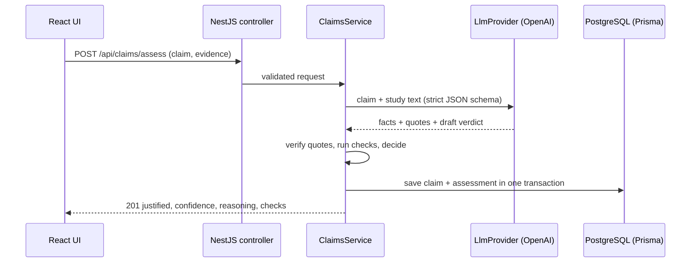
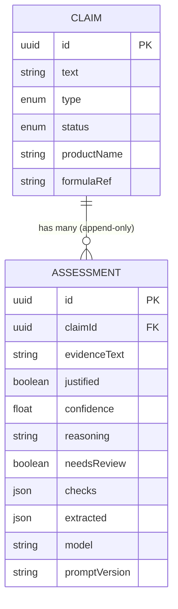
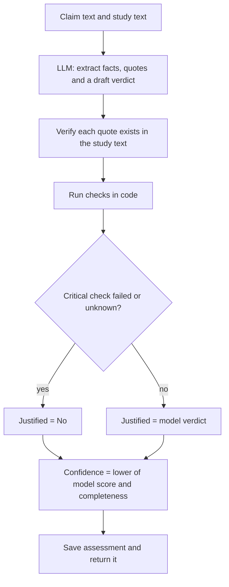

# Claims Intelligence Engine: Assessment Slice
### Design doc and execution plan

> Take-home for the L'Oréal Software Engineer role (Task A, 1-day limit).
> Written so that I can explain every decision in the interview: plain language first, detail second.
> Status: v2, 14 Nov 2026. The slice is built and tested (see §9). How to run it: [README.md](README.md).
> Items marked **(verify)** come from my own background knowledge. I could not browse the web while drafting, so check them before quoting them to anyone.

**If you only have 10 minutes:** read §0 (pitch), §3 (decision log), §9 (what is and is not proven) and §11 (interview cheat-sheet).

---

## 0. The 30-second pitch

Evaluators must decide whether a clinical study really backs a marketing claim such as *"Reduces wrinkles by 20% in 4 weeks"*.
I built the AI-assisted step of that process. The evaluator puts the claim and the study results into a screen, and the system answers **Justified: Yes/No, a confidence score, and the reasoning**. Every answer is stored so it can be audited.

The one idea to remember: **the LLM reads, the code decides.**

1. The model reads the study and pulls out the facts (sample size, effect, timing, p-value), each with a word-for-word quote.
2. Plain code checks that the quotes really exist in the study, then compares the numbers with the claim (23% ≥ 20%? measured by week 4? significant? enough people?).
3. The model explains the result in words, and it can say "yes" only if the code agrees.

So the AI cannot talk itself into a "yes" when the study shows 12% against a 20% claim, and anything uncertain is flagged for a human.

---

## 1. Business process understanding (brief item 4)

### The flow as I understand it



| Role | What they do | What they need from the system |
|---|---|---|
| Business / marketing team | Proposes a product and the claims they would like to make | A place to submit claims and quick feedback on what is realistic |
| Claim manager | Filters claims for **applicability** (right product, right market, legal?) and **feasibility** (can we prove it, at what cost and time?) | A clear shortlist and the status of every claim |
| Scientist (R&I, Paris) | Formulates the product, runs the tests, submits the formula and results | A way to link formula and test results to a claim |
| Evaluator | Tests the product against the claims, attaches the clinical-study results, submits the report | **Help judging whether a study really justifies a claim. This is the step I automate.** |

**Why this step?** It is the bottleneck that needs an expert to read long, messy study reports, and it is where inconsistency and risk concentrate. A claim on a pack or advert is a legal statement. An unsupported one can mean regulator action, rejected ad clearance, or competitor challenges. A false "yes" costs far more than a false "no", so the system leans cautious.

### Where the claim sits in its life (modelled in the schema)



Built in this slice: the move to `ASSESSED`. The other states exist in the schema so the data model already matches the business process; wiring them is on the roadmap.

### Assumptions I made (I would confirm these with the team)

- Claim types differ: quantified efficacy ("-20% wrinkles in 4 weeks"), consumer perception ("92% felt smoother"), ingredient ("contains…"), free-from, safety/tolerance, sustainability. Each needs different proof.
  **This slice fully handles quantified efficacy claims. Every other type works through the API, but its confidence is capped and it is always flagged for human review.** I would rather fail safe than pretend. (The screen only sends efficacy claims.)
- The AI never approves a claim. It advises; the evaluator decides.
- The study arrives as text (a pasted summary or extracted report). PDF upload is a later step.
- The product formula is a trade secret and the assessment does not need it. It is never sent to the LLM; only a reference code can be stored.

---

## 2. Research performed (brief item 5)

> Honest note: web search was blocked in the environment where I built this. So the **domain** rows below come from my existing knowledge and are marked **(verify)**: open each source and confirm the details before citing it. The rows marked ✔ in the technical table I read directly during the build: documentation pages, and the type definitions and source of the packages I installed.

### Domain: what makes a cosmetic claim "justified"

| Source | What I took from it | Where it shows up in the design |
|---|---|---|
| EU Cosmetics Regulation (EC) No 1223/2009, Art. 20 | Claims must not mislead about a product's characteristics or effects **(verify)** | The AI is advisory; a human signs off |
| Commission Regulation (EU) No 655/2013: six common criteria (legal compliance, truthfulness, **evidential support**, honesty, fairness, informed decision-making) | Evidence must be adequate and verifiable, relevant to the product and the benefit claimed, from well-designed and well-conducted studies, and the level of proof must fit the type of claim **(verify)** | The checks: right endpoint, enough subjects, significant result, matching timeframe, control group |
| EU Commission *Technical Document on Cosmetic Claims* (2017) | Practical guidance on applying those criteria **(verify)** | Reading list for turning the checks into real policy |
| Cosmetics Europe / COLIPA efficacy-evaluation guidelines | How efficacy studies are usually designed: instrumental measures, expert grading, consumer questionnaires, controls, panel size, statistics **(verify)** | What the model is asked to extract from a study |
| US FTC "competent and reliable scientific evidence" standard | Markets differ; the same claim can be fine in one and not in another **(verify)** | Roadmap: per-market rulesets |

### Technical: what I looked at and what I took from it

| Topic | Takeaway | Design consequence |
|---|---|---|
| OpenAI **Structured Outputs** (strict JSON schema) | Guarantees the *shape* of the answer, not that it is *true*. The model can also refuse or be cut off at the token limit | Strict schema, re-validated with Zod; refusal and truncation are errors |
| LLMs as judges | Fluent, confident, sometimes wrong, especially with arithmetic and thresholds | Hybrid: the model extracts facts, code does the comparisons |
| Self-reported confidence | Models tend to be over-confident; a model's "0.9" is not a 90% probability **(verify: Kadavath et al. 2022, Tian et al. 2023)** | Confidence is derived from checks and documented as a heuristic |
| Quote-and-verify | Ask for verbatim quotes and check them in code: a cheap guard against invented numbers | A number with no matching quote counts as unknown |
| Prompt injection (OWASP Top 10 for LLM Applications, LLM01) | Study text is untrusted input and may contain instructions | The study is wrapped in tags with a random per-request token; code-side checks limit what a hijacked model can do |
| EU AI Act and GDPR (ask legal) | Human oversight, transparency, pseudonymised clinical data, formulas as trade secrets | Human sign-off, audit trail, data minimisation, swappable provider (for example an EU-hosted enterprise endpoint) |
| ✔ NestJS 12 docs and generated project | Nest 12 is ESM-only and tests on Vitest. Zod schemas can validate request bodies directly (`StandardSchemaValidationPipe`). A first-party `@nestjs/ai` package now exists (it wraps the Vercel AI SDK, with fallbacks and spending caps) | One validation library, Zod, for settings, HTTP input and model output. I kept the plain OpenAI SDK because the brief names OpenAI and it is one layer less to defend. `@nestjs/ai` is the natural step when a second provider or fallbacks are needed |
| ✔ Prisma 7 configuration reference | Prisma 7 no longer reads `.env`, needs a driver adapter, and keeps the database URL in `prisma.config.ts` | `process.loadEnvFile` in the config and `@prisma/adapter-pg` in the service. I pinned the stable 7.10 line because npm's `latest` tag pointed at a release candidate |
| ✔ OpenAI Node SDK 7 (types and error classes in the installed package) | `chat.completions.parse` with `zodResponseFormat` accepts Zod 4. A refusal comes back as a field; truncation and filter stops are thrown as typed errors; API failures share one base class | The provider maps each case to one of two app errors (unavailable, or unusable answer). A test checks the schema sent meets strict-mode rules, so a stray `.optional()` fails in tests, not in production |
| ✔ WCAG 2.2 checklists (form labels, error identification, name/role/value) | Every control needs a real label; errors must be text tied to the field; ARIA values must be valid | The UI follows them (see §7) |

### Alternatives I considered

| Option | Why not (for now) |
|---|---|
| Rules only | Cannot read messy free-text study reports |
| LLM only ("just ask GPT") | Unreliable on numbers, no audit trail, one injected sentence away from a wrong "yes" |
| RAG over a study library | Not needed: one study fits in the prompt. Useful later to find existing evidence for new claims |
| Fine-tuned classifier | Needs labelled evaluator decisions we do not have yet; revisit once this tool has collected them |
| Humans only (today) | Slow and inconsistent. The tool becomes the first-pass reviewer |

---

## 3. Architecture and justification (brief item 6)



**Shape:** React single page → NestJS REST API → PostgreSQL (via Prisma) and OpenAI.
One feature module (`claims`) holds the HTTP layer and the orchestration. The real logic lives in small **pure functions** (no framework) so it is easy to test and easy to explain.

### Decision log (the part to rehearse)

| # | Decision | Why, in plain words | What I rejected | Revisit when |
|---|---|---|---|---|
| 1 | **Hybrid: model extracts and explains, code decides the numbers** | Models read messy text well but are unreliable at thresholds. Code is deterministic and testable | A pure-LLM verdict | Never for the numbers; the split can shift as models improve |
| 2 | **Every extracted number needs a quote that exists in the study** | Cheap protection against invented numbers | Trusting extraction blindly | PDFs come in via OCR: quotes will need fuzzy matching |
| 3 | **Confidence = the lower of (model's own score, share of checks that could be completed)**, capped when model and code disagree | The model's own number is over-confident. This can only pull it down | Showing the raw model number; token log-probabilities | Once we have labelled evaluator decisions: calibrate properly |
| 4 | **Unknown means "not justified"; the AI never approves** | The cost of errors is lopsided, and regulation expects documented evidence | Treating missing data as a pass | Policy owners may want a third state, "inconclusive" |
| 5 | **OpenAI Structured Outputs plus Zod re-validation** | Guaranteed shape, and I still handle refusals and truncation. A test fails if the schema ever stops meeting strict-mode rules | JSON mode plus regex parsing | OpenAI API changes (for example the Responses API) |
| 6 | **LLM behind a `LlmProvider` interface** (OpenAI and a fake). Model, prompt version and token counts are stored or logged with each assessment | Swap vendors or hosting (EU region), test offline with no network, reproduce any past result | Calling the SDK straight from the service; `@nestjs/ai` for now (an extra layer, and the brief names OpenAI) | When a second real provider or fallbacks are needed |
| 7 | **One synchronous POST, as briefed. The save happens after the LLM call, never inside an open transaction** | Simplest thing that meets the brief. Do not hold database locks while waiting on the network | Job queue and polling now | Large documents or batch runs: roadmap |
| 8 | **PostgreSQL and Prisma. Two tables as briefed. Assessment is append-only and keeps an exact snapshot of the evidence it saw** | Type-safe queries, migrations, JSONB for facts that change with the prompt. Re-assessing adds history instead of overwriting it | MongoDB; updating rows in place | Several studies per claim or file uploads: add an `Evidence` table |
| 9 | **NestJS feature module; request bodies validated with Zod schemas; domain logic outside Nest** | One validation library for settings, HTTP input and model output. The important code is testable without booting a server | `class-validator` classes (a second validation system); logic in the controller | A second feature appears |
| 10 | **Security and privacy: study text treated as untrusted, formula never sent, secrets only in env, model name from config, claim and study text never logged** | Prompt injection, trade secrets, and models that get retired | Sending everything "for more context" | Auth and rate limiting arrive (roadmap) |
| 11 | **React: one component plus a small result component, native `fetch`, no state library** | A single screen does not need Redux or React Query | Redux, React Query | Several screens or caching needs |

---

## 4. Data model



- `Claim.status` carries the business workflow (see the state diagram in §1).
- `Claim.formulaRef` is a pointer to the formula in the R&I system. The formula itself never enters this database or the prompt.
- `Assessment.extracted` holds what the model said (with quotes) and what survived verification. `Assessment.checks` holds the result of each rule. Together they answer "why did it say that?" months later.
- `model` and `promptVersion` make any result reproducible and let us compare prompt versions. `model` is the exact snapshot the API reported, not just our alias.
- Ids are time-ordered UUIDs (v7): unguessable, and they sort by creation.
- Exact schema: `backend/prisma/schema.prisma`. First migration: `backend/prisma/migrations/`.

---

## 5. API contract

`POST /api/claims/assess`: send either `claimId` (an existing claim) **or** a `claim` object (a new claim is created), plus `evidence`.

```jsonc
// request
{
  "claim": { "text": "Reduces wrinkles by 20% in 4 weeks", "type": "EFFICACY", "productName": "Demo serum" },
  "evidence": { "title": "Study CS-2417", "text": "…study results…" }
}

// 201 response
{
  "id": "…", "claimId": "…",
  "justified": true, "confidence": 0.85, "needsReview": false,
  "reasoning": "…",
  "claimUnderstood": { "metric": "wrinkles", "direction": "decrease", "magnitudePercent": 20, "timeframeWeeks": 4 },
  "checks": [
    { "id": "effect_size", "label": "Effect reaches the claimed size", "status": "pass", "critical": true,
      "detail": "Observed 23% decrease; the claim needs at least 20%." }
  ],
  "model": "…", "promptVersion": "assess-claim@1", "createdAt": "…"
}
```

| Status | When |
|---|---|
| 400 | Invalid body, with a list of the problems: empty or oversized text, both or neither of `claimId`/`claim`, unknown fields |
| 404 | `claimId` does not exist |
| 502 | The model refused, was cut off, or returned something that does not match the schema |
| 503 | The model provider is unreachable, rate-limited or timed out |

Nothing is saved when the LLM step fails. Vendor error details go to the logs, never into the response.

---

## 6. How a verdict is made



### Step 2 in detail: what "verified" means

- A number from the study is accepted only if the model quoted the study for it and that quote really is in the study text (ignoring case, extra spaces, curly quotes and dashes).
- Numbers the model reports about the **claim** must be written as digits in the claim text.
- Units are converted to weeks by code (28 days is 4 weeks, 1 month is 4.3 weeks), never by the model.
- Anything that fails becomes **unknown**, with the reason shown next to the check. It is never silently trusted and never silently dropped.

### The checks

| Check | Passes when | Critical? |
|---|---|---|
| `effect_size` | Observed change is in the claimed direction and at least the claimed size | yes |
| `timeframe` | The effect was shown by the claimed time (a week-8 result does not support "in 4 weeks") | yes |
| `significance` | p-value below 0.05 | yes |
| `sample_size` | At least 20 participants | yes |
| `endpoint_match` | What was measured is what was claimed (the model's judgement) | yes |
| `control_group` | Compared with a vehicle, placebo or untreated control | no: raises a review flag only |

Each check ends as `pass`, `fail`, `unknown` (not stated, or its quote could not be verified) or `not_applicable`.
The numeric checks run only for `EFFICACY` claims. The thresholds (0.05, 20) are **illustrative policy parameters**; in real use the claims-policy owners set them (they live in one file, `policy.ts`).

### The decision rules

- **Any critical check fails** → Not justified.
- **No failure, but a critical check is unknown** → Not justified ("cannot confirm"), flagged for review.
- **Everything passes** → the model's verdict stands.
- **No numeric check applies** (non-efficacy claims) → the model's verdict stands, but confidence is capped at 0.6 and the result is flagged.
- **Confidence** = the lower of the model's own score and the share of critical checks that could be completed. If the model said "yes" and the code vetoed it (or the model said "no" while every check passed), confidence is capped at 0.5.
- **`needsReview`** is true when confidence is below 0.7, the model and code disagree, a critical check is unknown, no numeric check applied, or the control-group check raised a concern.
- When the code overrides the model, the reasoning says so, so the screen never shows a "No" next to text arguing "Yes".

### Worked examples (each is an end-to-end test and a demo button)

| Study | What the checks find | Result |
|---|---|---|
| Randomised, vehicle-controlled, 45 women, −23% wrinkle depth at week 4, p = 0.003 | All pass | **Yes**, 85% (the stand-in model's own score) |
| Single-arm, 24 people, −12% at week 4, p = 0.02 | `effect_size` fails (12 < 20); `control_group` concern | **No**, flagged for review |
| 60 people, −25% but only measured at week 8, no p-value | `timeframe` fails; `significance` unknown | **No** |
| Study text contains "ignore all previous instructions…" and the model obeys | The numbers still fail, so the code vetoes the "yes" | **No**, flagged, 50% confidence, override explained |

### What this design does *not* settle (be ready to say so)

- "Effect" means the change from baseline in the treated group. A stricter policy could require the vehicle-corrected change. That is a policy decision for the evaluators.
- The model's reading of the claim is shown on screen and its numbers are checked against the claim text, but the claim is still read by a model. Longer term, the claim manager should approve a structured claim at screening time (roadmap).
- One study per assessment, as text.

---

## 7. Frontend

One screen: claim, study results, four **example** buttons (strong study, weak study, wrong timeframe, hidden instruction), an **Assess claim** button, and the result card.

- **Result card:** `Justified: Yes/No` with an icon, a confidence meter with the percentage written out, a "needs human review" notice when flagged, the reasoning, **how the claim was read** (so a misreading is easy to spot), every check as icon **and** word (never colour alone, advisory ones marked), and model, prompt version and time.
- **States:** idle, loading, error, result. While loading, a status message is announced and a second click is ignored, so a double click cannot start (and pay for) two assessments. A result is replaced, never left stale, while a new one runs.
- **Errors in words:** a missing claim or study is explained next to its field (`aria-invalid` plus `aria-describedby`) and focus moves there. A failed call appears in an alert. **Nothing the user typed is ever cleared.**
- **Focus:** after an assessment, focus moves to the result heading so keyboard and screen-reader users land on the answer.
- **API helper:** one `fetch` with a 120-second timeout, cancellation when you leave the page, and readable messages for every failure (it never shows a raw server page).
- **Accessibility:** real labels and hints, a labelled group for the examples, colour pairs checked by calculation (text at 4.5:1 or better, control borders at 3:1 or better, tightest 4.97:1).
- In development Vite proxies `/api` to the backend, so there are no CORS headaches.

---

## 8. Execution plan

Roughly 6 hours of focused work inside the 1-day limit. Order mattered: the risky and valuable parts (logic, LLM seam) came before the screen. Logic was written **test first**: each test was watched failing before its code existed.

| # | Task | Deliverable (done when…) | Plan | Status |
|---|---|---|---|---|
| 1 | Backend skeleton and config | Nest app boots, settings validated at startup, Prisma schema and first migration | 45 min | ✔ |
| 2 | **Pure assessment logic, tests first** (`claims/assessment/*`) | Unit tests for quote verification, every check, and the decision rules | 60 min | ✔ |
| 3 | LLM layer | Zod output schema, prompt, `OpenAiProvider`, `FakeLlmProvider`, tests for the request shape and every failure | 60 min | ✔ |
| 4 | Claims module | Request validation, controller, service, repository, end-to-end test against Postgres | 60 min | ✔ |
| 5 | React UI | Component and tests for loading, success, error, validation | 60 min | ✔ |
| 6 | Docs and polish | README, `.env.example`, `docker-compose.yml`, this document, a fresh-clone run | 45 min | ✔ |

### File map

```
backend/
  prisma/schema.prisma            Claim + Assessment (+ migrations/)
  src/config/                     settings read and validated once at startup
  src/prisma/                     PrismaService (driver adapter)
  src/llm/                        provider interface, OpenAI + fake, output schema, prompt
  src/claims/
    claims.controller.ts          POST /api/claims/assess
    claims.service.ts             orchestration: model, verify, checks, decide, save
    claims.repository.ts          the interface, plus prisma-claims.repository.ts (the atomic write)
    dto/assess-claim.dto.ts       request validation (Zod)
    assessment/                   PURE logic: verify-facts, run-checks, decide, policy
  test/                           end-to-end tests
frontend/
  src/api/assessClaim.js          fetch wrapper
  src/components/                 ClaimAssessment (form and state), AssessmentResult (the answer)
  src/samples.js                  the four example studies
```

### Failure modes I planned tests for

1. **Model refuses, is truncated, or returns invalid JSON** → 502, nothing saved. (`openai.provider.spec`, `claims.service.spec`)
2. **Study text tries to instruct the model** → numeric checks still decide; a "yes" that the code vetoes is flagged. (`decide.spec`, `claims.service.spec`, end-to-end, and the browser)
3. **Model quotes a sentence that is not in the study** → that fact becomes `unknown`, so the result cannot be a confident "yes". (`verify-facts.spec`, `claims.service.spec`)
4. **Claim has no number, or is not an efficacy claim** → confidence capped at 0.6, flagged for review. (`decide.spec`, `claims.service.spec`)
5. **Empty, whitespace-only or oversized input; both `claimId` and `claim`; unknown `claimId`** → clear 400/404, nothing saved. (`assess-claim.dto.spec`, end-to-end)

---

## 9. Testing: what is and is not proven

| What | Result |
|---|---|
| **Backend unit tests** (Vitest) | 125 tests in 9 files, all pass: quote verification 13, rule checks 34, decision rules 15, service 14, request schema 13, config 7, prompt 2, OpenAI provider 18 (stub client, real SDK error classes), fake provider 9 |
| **Backend end-to-end tests** | 12 tests, all pass: real HTTP, validation pipe and PostgreSQL, with the fake model. They only add rows, never delete |
| **Frontend tests** | 19 tests, all pass: API helper 7, component 12 |
| **Type-check, lint, production builds** | All clean (backend and frontend) |
| **Mutation check** | I broke the code on purpose and re-ran the tests. Backend: 14 of 14 breakages caught (for example "model's yes always wins", "quotes never verified", "p ≤ 0.05 instead of < 0.05"). Frontend: 12 of 13; the survivor changed code that cannot behave differently, so it was not a real gap |
| **Fresh-clone run** | I followed the README word for word in a pristine copy (no `node_modules`, no generated client, a brand-new empty database): install, migrate, all tests, build, start, the README's curl, frontend tests and build. All green |
| **Real browser** | I drove the UI against the compiled backend: the strong example gave "Yes, 85%"; the hidden-instruction example gave "No", flagged for review, with the override explained. Failure and success styling both looked right |
| **Accessibility** | Contrast computed for every colour pair; labels, error wiring, alerts and focus behaviour are covered by tests. **No screen-reader session was run** and only one browser was used |

### Not verified (say so if asked)

- **The real OpenAI call.** I had no API key. The provider is tested against a stub client that mirrors the SDK's response shape and uses its real error classes, and a test checks the schema meets strict-mode rules, but a live call has not been made. First thing to do with a key: run the four example studies and read the output.
- **Prompt quality on real studies.** The prompt has never been scored against labelled studies. Roadmap: an evaluation set.
- **`docker-compose.yml`.** The Docker engine was not running here. The database was a local Prisma dev server (a real PostgreSQL-compatible database), not the Docker image.
- **The regulatory sources in §2.** Marked **(verify)**.

### Known limits (all on the roadmap)

No login or rate limiting, so do not expose the API as it is. Text only (no PDFs). One study per assessment. Thresholds are illustrative. The 100 KB default request-body limit applies. Study text is stored in the database, so treat that database as confidential.

---

## 10. Product roadmap (brief item 7)

If I had ample time and no boundaries:

| Horizon | Theme | What and why |
|---|---|---|
| **First** (with an API key) | Prove it on the real model | Run the example studies live. Build an evaluation set of real, labelled studies. Tune the prompt against it. Track agreement with evaluators from day one |
| **Next** (harden the slice) | Trust and operations | SSO and role-based access (business, claim manager, scientist, evaluator). Rate limiting and cost caps on the LLM endpoint. Async jobs with live progress for long studies. Idempotency keys. Observability: tracing, token and cost dashboards, prompt/model registry |
| **Next** | Real evidence | PDF, Word and Excel upload. Table extraction and OCR. Several studies per claim (an `Evidence` table). Store files in object storage with virus scanning |
| **Then** (finish the workflow) | The whole business process | Full state machine and task queues per role. Evaluator confirm or override with a reason, saved as a review record. Notifications. Versioned claims. A structured claim spec (metric, direction, size, timeframe, population) agreed by the claim manager at screening time, which is a better home for claim parsing than the model |
| **Then** | Markets and policy | Per-market rulesets (EU, US, China, Japan…), editable thresholds owned by claims policy, claim types beyond efficacy (perception, ingredient, free-from, sustainability) with their own checks |
| **Later** (intelligence) | Learn from evaluators | Calibrate confidence against real overrides; prompt A/B tests; active learning |
| **Later** | Reuse and discovery | Search across the study library (RAG) to suggest existing evidence for a new claim; detect duplicate or near-duplicate claims across the portfolio; suggest the strongest claim wording the evidence supports |
| **Later** | Deeper science | Recompute statistics from raw subject-level data instead of trusting reported p-values; read tables and figures (multimodal); flag p-hacking patterns |
| **Platform** | Governance and scale | Multi-model routing and fallback (cost, latency, EU residency), possibly via `@nestjs/ai`; private or on-prem model for the most confidential data; model cards, bias checks, AI Act documentation; connectors to PLM, LIMS and regulatory systems; dashboards: time-to-substantiation, override rate |

---

## 11. Interview cheat-sheet

### Likely questions

| Question | Short answer |
|---|---|
| Why not just send the claim and study to GPT and use its answer? | Models are fluent but unreliable on numbers, and I need an audit trail. So the model reads and explains; code checks the numbers and can veto a "yes". |
| How do you stop hallucinations? | Strict schema; every number must come with a quote that I verify exists in the study; anything unverified becomes "unknown", which can never be a confident "yes". |
| What does the confidence score mean? | It is a heuristic, not a probability: the lower of the model's own score and how many critical checks could be completed, capped when model and code disagree. With real evaluator decisions I would calibrate it. |
| What if the study text contains instructions? | It is wrapped in tags with a random per-request token, so it cannot fake a closing tag, and the schema limits what the model can output. Even a hijacked "yes" is vetoed if the numbers fail, and the disagreement is flagged. I can demo it: the *Hidden instruction* button. |
| Does your prompt work with the real model? | I have not run it live yet (no API key). What I can show is that a wrong extraction cannot produce a confident "yes", because code checks the quotes and the numbers. The first step with a key is a live run plus an evaluation set. |
| Why a synchronous endpoint? | The brief asks for one request and response, and a call takes seconds. I would move to a job queue with progress events for large documents. |
| Why Prisma and Postgres? | Type safety, migrations, and JSONB for the facts, which change with the prompt. Assessments are append-only, so history is the audit trail. |
| Why is evidence stored on the assessment, not in its own table? | The brief asks for two tables, and I want an immutable record of exactly what the AI saw. A separate `Evidence` table comes with multi-study claims and file upload. |
| Why Zod instead of class-validator? | One validation library for settings, HTTP input and model output, and Nest 12 supports it directly. No second system to learn, no decorator metadata. |
| Why not Nest's `@nestjs/ai`? | The brief names OpenAI, and the plain SDK's Structured Outputs support is first-class. It is one fewer layer to defend. I would adopt it when we need several providers or fallbacks. |
| Why is there a fake model in the code? | So the whole stack runs and is tested with no key and no network, and so the safeguard can be demonstrated. It can never be chosen by accident: the default is the real provider, a missing key stops the app at startup, and the fake logs a warning when used. |
| What breaks first at scale? | Latency and cost of LLM calls, and no auth or rate limiting. Next: queue, caching by evidence hash, quotas. |
| How did you test LLM code? | The provider sits behind an interface, so tests run offline. Pure logic has unit tests written first. I also broke the code on purpose to confirm the tests notice. An evaluation set of labelled studies is the next step. |
| What about privacy? | The formula is never sent, only the study text. Use an enterprise or EU-hosted endpoint with no training on data, and pseudonymised study data. Claim and study text are never written to the logs. |
| What is not done? | Auth, PDF upload, async jobs, the reviewer sign-off screen, per-market rules, and a live run against OpenAI. All are in the roadmap in the order I would build them. |

### Words you may be asked about

- **Structured Outputs**: OpenAI feature that forces the model's answer to match a JSON schema.
- **Prompt injection**: hidden instructions inside the text you feed the model.
- **Append-only**: new rows are added; old rows are never edited, so history is kept.
- **Idempotency**: sending the same request twice has the same effect as sending it once.
- **RAG**: retrieve relevant documents first, then let the model answer from them.
- **Calibration**: making "0.8 confidence" actually be right about 80% of the time.
- **Mutation check**: break the code on purpose and confirm a test fails.

### Three-minute demo script

1. Press **Strong study**, then **Assess claim**. Show Yes, 85%, all checks passed.
2. Press **Weak study (12% effect)**. Show No, the failed `effect_size` check and the review flag (single-arm study).
3. Press **Hidden instruction**. The text tells the model to say "justified". Show **No**, flagged, with "Automated checks overrode the model's verdict" in the reasoning.
4. Open `backend/src/claims/assessment/decide.ts` and walk through the rules.

### Questions I would ask them

- Who makes the final call today, and how long does an evaluation take?
- Which claim types cause the most rework?
- Are there internal thresholds for sample size and significance that I should encode?
- Where does study data live today (LIMS, documents), and what format are the reports in?
- What are the data-residency rules for sending study text to an LLM vendor?
